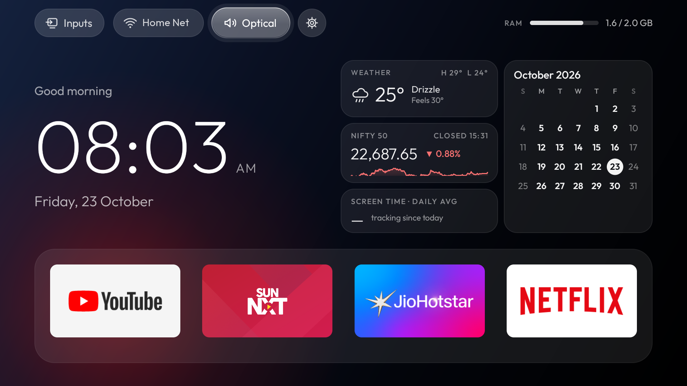

# Acer 50" Google TV (R4G / MOKA, Android 14): debloat + Glass Home launcher

Debloats an Acer R4G Google TV over ADB and replaces the stock home screen with **Glass Home**, a
small custom launcher (no Gradle, no AndroidX, ~51–68 MB PSS).



*Glass Home v1.4 on the TV (the Wi-Fi name and the weather location have been replaced).*

Everything is reversible. Nothing is deleted from the system partition: 11 packages are **disabled**
and 20 are **hidden for user 0** (`pm uninstall -k --user 0`). Hiding is needed because Acer's boot job
re-enables some disabled apps ([see below](#hidden-apps-and-acers-boot-time-re-enable)). A factory reset
brings every app back.

> Written for one specific TV (Acer R4G, manufacturer MOKA, Realtek chipset, Android 14 / SDK 34,
> 32-bit ARM, 1920×1080 UI at density 320). Package names and vendor quirks will differ on other sets.

## Quick start

1. On the TV, turn on **USB debugging** (Settings → System → Developer options) and note its IP
   (Settings → Network & Internet → your network).
2. Tell the scripts where the TV is:
   ```
   export TV_IP=<your TV's IP>
   ```
3. Build Glass Home, install it and make it the home screen (building needs a JDK and the Android
   build tools, see [Rebuild](#rebuild)):
   ```
   bash install.sh
   ```
   Accept "Allow USB debugging?" on the TV the first time (tick **Always allow**).
4. Set your weather location ([Widgets](#widgets)). Until you do, the weather card says "No location".
5. Turn USB debugging **off** again when you're done.

Every script takes the TV's IP as its first argument, or reads `TV_IP` from the environment. Nothing
is hardcoded. The first run of any script creates `.venv/` and installs `adb-shell rsa pyasn1 cryptography`.

The Python client (`tvadb.py`) is used instead of stock `adb` because macOS Local Network privacy
blocks the `adb` binary from reaching the TV.

## Folder contents

| Path | What it is |
|---|---|
| `install.sh` | Builds and installs Glass Home (or `--apk FILE` to install a ready-made APK), hides the setup wizard, disables the stock launcher and makes Glass Home the home app |
| `restore.sh` | Undoes everything: un-hides `hidden-packages.txt`, re-enables `disabled-packages.txt`, makes Google TV home again |
| `tvadb.py` | Small ADB client (Python `adb-shell`): `tvadb.py IP "shell cmd" …`, `--push LOCAL REMOTE`, `--install APK` |
| `hidden-packages.txt` | The 20 packages hidden for user 0 |
| `disabled-packages.txt` | The 11 packages disabled for user 0 |
| `runner.sh` / `runner.py` | Optional job-queue runner (`queue/` → `results/`, screenshots in `shots/`). Only needed when the machine giving commands can't reach the TV |
| `glass-launcher/` | Launcher source, `build.sh` and signing key `debug.jks`. No prebuilt APK is committed |
| `HISTORY.md`, `SUMMARY.md` | Timeline and state-by-topic notes from the original setup |

`install.sh` only debloats what Glass Home needs (stock launcher + setup wizard). The other packages
in the two lists were removed by hand in small batches; the commands are under
[Change one app](#change-one-app).

## What was removed

| Category | Hidden (`pm uninstall -k --user 0`) | Disabled (`pm disable-user --user 0`) |
|---|---|---|
| Telemetry | `com.google.android.feedback`, `com.apps.function.gdpr` | `com.android.tv.feedbackconsent`, `com.mk.tv.systemserver` |
| Content & ads | `com.apps.esticker`, `com.apps.esticker3`, `com.google.android.apps.tv.dreamx` (ambient screensaver) | `com.apps.mk.wd` (S-Channel ads), `android.autoinstalls.config.scbc.device` (promo auto-installs), `com.realtek.leanbacklauncher.partnercustomizer` |
| Background / preloaded | `com.apps.tvmanager` (cleaner), `com.apps.scast`, `com.mk.tv.meeting.service`, `com.apps.biz.mt` (Meeting Mode), `com.apps.function.audiolink`, `com.mk.tv.timeclock` (World Clock) | `com.apps.wifihotspot` |
| Unused apps | Google TV/Play Movies (`com.google.android.videos`), Play Games (`com.google.android.play.games`) | MX Player, JioCinema, YuppTV, File Manager+ |
| Owner's choice | Google Assistant (`com.google.android.katniss`), Miracast (`com.creative.fastscreen.tv`), firmware updates (`com.apps.ota`, `com.apps.authota`, `com.realsil.ota`, `com.google.android.tv.dfuservice`) | |
| For the launcher | Setup wizard (`com.google.android.tungsten.setupwraith`) | Stock launcher (`com.google.android.apps.tv.launcherx`) |

Kept on purpose: Live TV (`com.realtek.tv`) and every input service (HDMI/AV/ATV/DTV), the source
menu, `com.mk.service.tvmidware` (talks to the TV board), remote/Bluetooth/key handlers, Gboard,
Play Store, Play Services, TV Settings, Chromecast, USB Media Player.

## Change one app

```
# bring back a hidden app
.venv/bin/python tvadb.py "$TV_IP" "cmd package install-existing com.apps.ota"
# re-enable a disabled app
.venv/bin/python tvadb.py "$TV_IP" "pm enable com.apps.mk.wd"
# hide / disable one
.venv/bin/python tvadb.py "$TV_IP" "pm uninstall -k --user 0 <package>"
.venv/bin/python tvadb.py "$TV_IP" "pm disable-user --user 0 <package>"
```
Update `hidden-packages.txt` / `disabled-packages.txt` to match so `restore.sh` stays accurate.
Run one `pm` command per shell call; chained ones can stop early. Use `pm list packages --user 0`
(without `--user 0` it also lists apps installed for user 10). After any change to which apps are
enabled or hidden, **test with a real reboot** (power-cycle at the socket).

On the TV itself: long-press OK on a tile in Glass Home to open that app's info page.

## Undo everything

```
bash restore.sh                      # Google TV home back, Glass Home kept as an app
bash restore.sh --remove-launcher    # also uninstall Glass Home
```

## Hidden apps and Acer's boot-time re-enable

On every boot, Acer/Realtek's modified `FallbackHome` (in `com.android.tv.settings`) runs
`SetPmodServiceJob` → `disableOrEnableApk(1)`. That force-re-enables any *disabled* app on a
hard-coded list of 60 packages (unless the factory `P_MODE` flag is set, which isn't possible without
root). It skips apps that aren't installed, so apps on that list must be hidden, not disabled.

The setup wizard is the important one. Its `RecoveryActivity` claims HOME at priority 1, and Android
always prefers a higher-priority system HOME over a third-party launcher (capped at 0). With the stock
launcher disabled, the wizard loops trying to restore it and the screen goes black. Android 14 doesn't
let ADB disable just that one screen ("Shell cannot change component state"), so the whole wizard is
hidden. Settings' own `FallbackHome` remains as a safety net if Glass Home ever crashes.

**Never un-hide or re-enable `com.google.android.tungsten.setupwraith` on its own while the stock
launcher is disabled.** `restore.sh` re-enables the stock launcher first, which is safe.

## Glass Home

Remote: D-pad moves the glass highlight. Up from the dock goes to the top bar (Inputs, Wi-Fi, Audio,
Settings; the RAM gauge on the right is display-only); Down from the dock scrolls into the 4-column
app grid; Back jumps to the dock; Home (while home) also returns to the dock. OK opens; long-press OK
opens app info. Inputs pill: HDMI 1–3, AV, Live TV.

Runtime config lives in `/sdcard/Android/data/com.madhu.glasslauncher/files/` and needs no rebuild.
After pushing a file, run `"am force-stop com.madhu.glasslauncher" "input keyevent KEYCODE_HOME"`.

### Change the dock

Put up to four package names, in order, in `dock.txt` and push it:
```
printf 'com.google.android.youtube.tv\ncom.suntv.sunnxt\nin.startv.hotstar\ncom.netflix.ninja\n' > dock.txt
.venv/bin/python tvadb.py "$TV_IP" \
  --push dock.txt /sdcard/Android/data/com.madhu.glasslauncher/files/dock.txt \
  "am force-stop com.madhu.glasslauncher" "input keyevent KEYCODE_HOME"
```
Delete the file on the TV to go back to the built-in default (YouTube, Sun NXT, JioHotstar, Netflix,
set in `DEFAULT_DOCK` at the top of `HomeActivity.java`).

Package names: Netflix `com.netflix.ninja`, YouTube `com.google.android.youtube.tv`,
Prime Video `com.amazon.amazonvideo.livingroom`, JioHotstar `in.startv.hotstar`,
Sun NXT `com.suntv.sunnxt`, ZEE5 `com.graymatrix.did`, SonyLIV `com.sonyliv`,
FanCode `com.fancode.tv`, YouTube Music `com.google.android.youtube.tvmusic`,
YouTube Kids `com.google.android.youtube.tvkids`, Live TV `com.realtek.tv`.

### Change the wallpaper

Default is a static midnight-blue → black gradient (`bgGrad` in `buildUi()` of `HomeActivity.java`).
For an image (ideally 1920×1080 JPG; it's dimmed 50% so text stays legible), push it as
`wallpaper.jpg`:
```
.venv/bin/python tvadb.py "$TV_IP" \
  --push ~/Pictures/wall.jpg /sdcard/Android/data/com.madhu.glasslauncher/files/wallpaper.jpg \
  "am force-stop com.madhu.glasslauncher" "input keyevent KEYCODE_HOME"
```
Delete it on the TV to return to the gradient.

### Widgets

| Widget | Source | Refresh |
|---|---|---|
| Top bar | Inputs, Wi-Fi (network name), Audio output, Settings; RAM gauge far right. A soft fade appears only when the grid scrolls under it | RAM every 5 s while home is visible |
| Weather | Open-Meteo, no API key, °C | Hourly (on return home if the hour passed) |
| Nifty 50 | Yahoo Finance chart API `^NSEI`, **unofficial**, may lag NSE slightly | Every 60 s Mon–Fri 09:15–15:30 IST while home is visible; otherwise last close (NSE holidays not known) |
| Screen time | Glass Home's own screen-on/off log (Android's usage history on this TV is dated 2027 after a clock glitch and records nothing) | Once a day after 6 am; 7-day daily average |
| Calendar | Local | Midnight |

Nothing refreshes while you're inside another app. Screen time is counted only while Glass Home's
process is alive (it normally is, as the home app); a reboot mid-session can lose that session.

The weather card has no built-in location. Set yours with `widgets.txt` (decimal degrees; `place` is
the label shown on the card). Changing it drops the old location's cached weather.
```
printf 'lat=51.51\nlon=-0.13\nplace=London\n' > widgets.txt
.venv/bin/python tvadb.py "$TV_IP" \
  --push widgets.txt /sdcard/Android/data/com.madhu.glasslauncher/files/widgets.txt \
  "am force-stop com.madhu.glasslauncher" "input keyevent KEYCODE_HOME"
```

Permissions: location (granted by `install.sh`, used only to read the Wi-Fi name) and INTERNET.

### Audio output pill

Shows the TV's current output (Settings.Global `speaker_index`: 0 TV speaker, 1 S/PDIF optical,
2 HDMI ARC). Picking an output sends Realtek's own exported toggle broadcast
(`com.realtek.slices/.OutputDeviceReceiver`, action `com.realtek.device_output_key`), which switches
TV speaker ↔ optical, then re-reads the setting to confirm. No extra permission is needed. Optical is
always listed because the link is one-way and the TV can't tell whether a speaker is attached. HDMI ARC
appears only while the TV reports it in use; choosing it opens TV Settings, since it needs HDMI-CEC
control that apps can't use.

There's no Bluetooth pill: the TV's Bluetooth settings screens require `WRITE_SECURE_SETTINGS`.

### Data kept on the TV

| Data | What is stored | Kept |
|---|---|---|
| Weather | Last response only (~1 KB), overwritten hourly | Dropped if older than 24 h |
| Nifty 50 | Last price, previous close and today's closes (a few KB) | Dropped if older than 24 h |
| Screen time | One number per day (ms on) + the cached average | Today + last 7 days |
| Calendar, RAM | Nothing | n/a |

All of it lives in the launcher's private settings file and doesn't grow. "Clear storage" in its app
info, or uninstalling, wipes it.

### Rebuild

`glass-launcher/build.sh` needs a JDK plus either the Android SDK (`$ANDROID_HOME` or
`~/Library/Android/sdk`: uses `build-tools/*` and `platforms/android-*`) or Debian/Ubuntu's
`apt install aapt dalvik-exchange zipalign apksigner android-sdk-platform-23`. No Gradle, no AndroidX:
plain framework views, with a fixed-layout grid and its own focus model instead of RecyclerView.

Bump `versionCode` in `AndroidManifest.xml`, then `bash install.sh`.
Sign with `glass-launcher/debug.jks` (password `android`): Android refuses to update the installed app
if the key changes. It's a throwaway debug key, published here on purpose.

Design notes: 960×540 dp layout, Outfit (SIL OFL, `assets/fonts/OFL.txt`), a single glass highlight
animated with a damped spring, ambient glow colour sampled from the focused dock banner, no blur,
no video, no polling (clock via TextClock, Wi-Fi name via broadcasts, greeting via one timer per hour).

Versions: 1.0 black, 1.1 gradient, 1.2 top bar + widgets, 1.3 polish + data limits, 1.4 clock format +
audio output pill, 1.5 no built-in weather location.

## Known limits

- **Prime Video remote button** can't be remapped without root. The Realtek key service turns
  scancode 763 into vendor keycode 2055, and `com.realtek.android.globalkeyhandler` launches Prime
  Video by a hard-coded package name.
- `input keyevent 178` (TV_INPUT) doesn't open the source menu on this set; use
  `am start -a com.android.tv.action.VIEW_INPUTS`.
- `screencap` + native ADB pull/push can hang; `tvadb.py` moves files as base64 over the shell.

## When you're done

Turn **USB debugging off** (Settings → System → Developer options). Turn it back on whenever you
want to run a script or change the dock, wallpaper or widgets.
